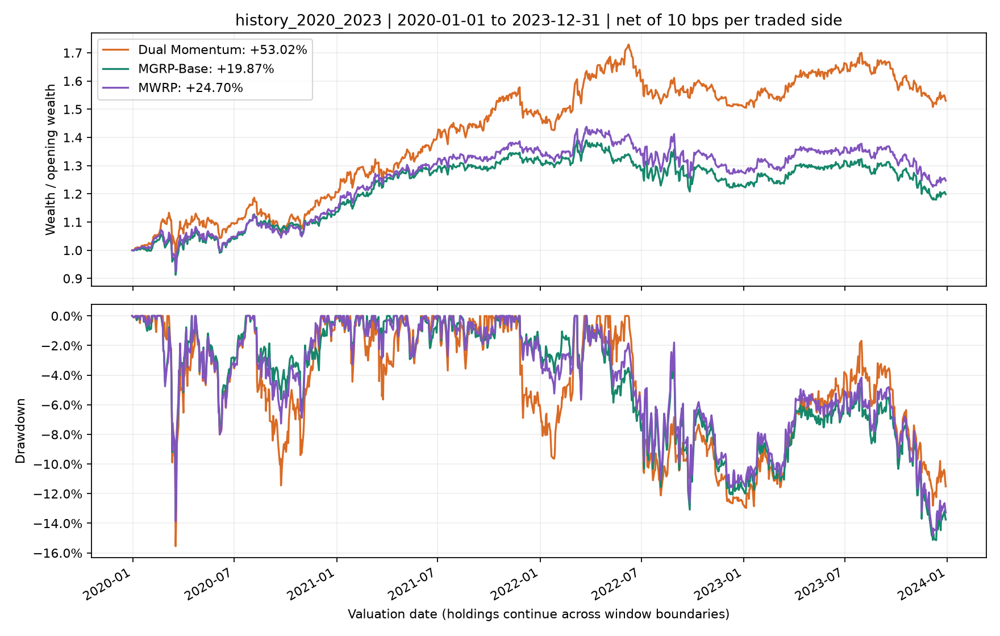
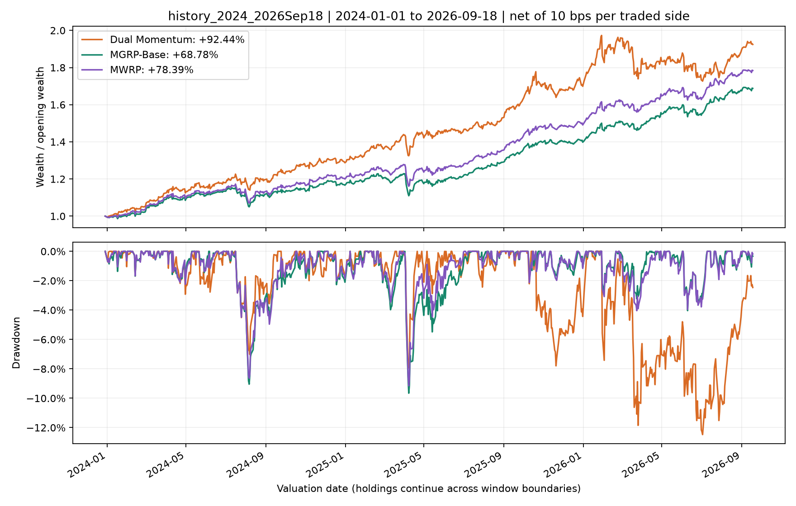
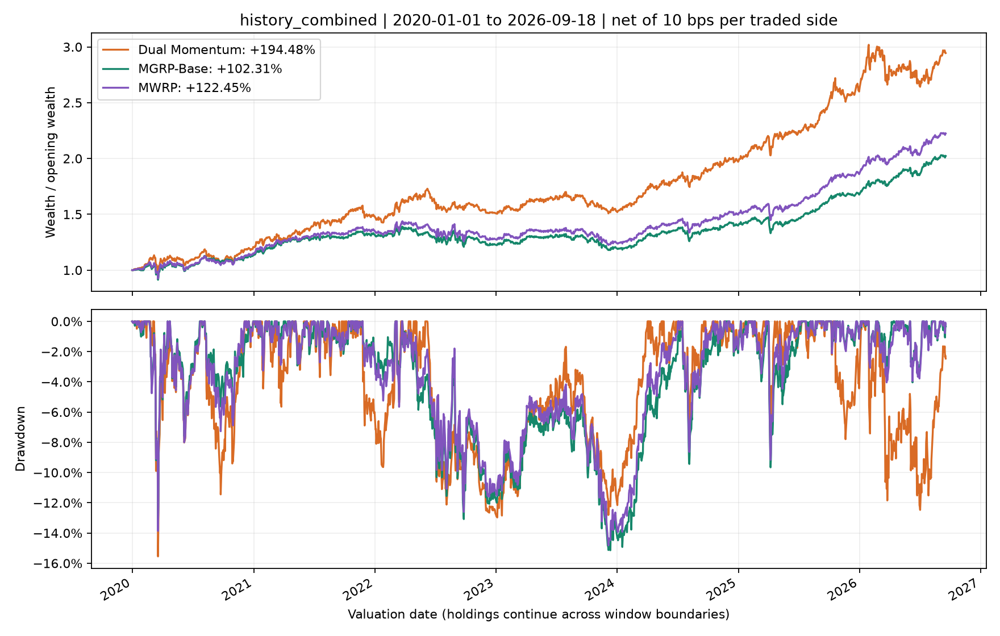
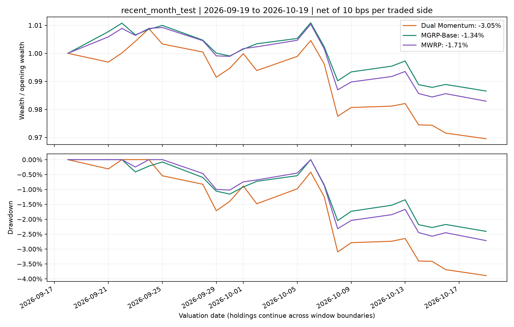
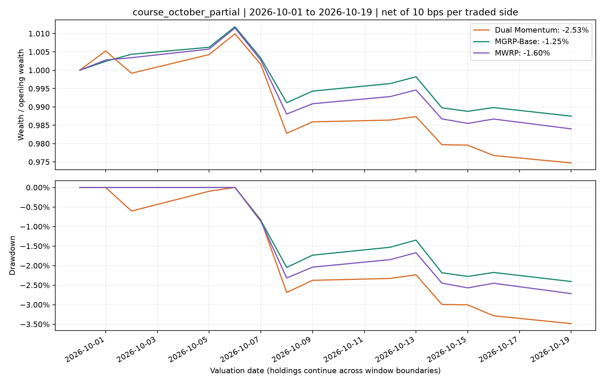

# 当前窗口回测结果

采用归档行情，数据截止2026-10-19；未下载数据，未调整策略参数，无单独模型训练或参数搜索。
共同历史始于2014-11-07。2014-11-07至2019-12-31用于历史数据准备；EWMA在252个日收益后初始化，
这不是必须五年的训练期。交易模拟从2020-01-03首次建仓开始。

历史回测A、B与最近一个月测试不重叠。合并历史是A+B；十月阶段性结果是最近一个月测试的子集。
结果属于策略开发后的历史评价，不声称未受策略选择影响的样本外检验。十月阶段性结果尚未覆盖完整课程测试期。

窗口之间延续实际持仓，只重新归一化展示财富。最近一个月测试基准为9月18日收盘，第一笔收益为9月21日；
延续9月2日建立的持仓，9月30日产生信号、10月2日执行常规调仓。不在测试边界额外交易。
费用按实际买卖金额单边10bps扣除，并比较5/25bps；Sharpe采用RF=0、sqrt(252)年化。
短窗口以累计净收益为主；年化指标仅供描述，不能用21个日收益证明长期优势。
月度胜率只统计起止均完整的自然月；两个短窗口没有完整自然月，故留空。
交易笔数是逐资产买卖成交记录数量，不等于完整往返交易数量；每日胜率不等于盈利交易占比。
收益归因按各窗口期初财富计量；风险预测汇总只纳入完整且全部落在该窗口内的持有周期。
因此短测试窗口可能没有完整持有周期，其风险预测误差汇总留空，不用跨窗口未来数据补齐。

## 历史回测 A：2020-01-01—2023-12-31

实际收益日期：2020-01-03—2023-12-29；期初基准：2019-12-31。

| Strategy      |   Observations | Net_Total_Return   | Net_CAGR   |   Sharpe | Annual_Volatility   | Max_Drawdown   |   Rebalances |   Asset_Trade_Fills | Trading_Cost_Per_Opening_NAV   |
|:--------------|---------------:|:-------------------|:-----------|---------:|:--------------------|:---------------|-------------:|--------------------:|:-------------------------------|
| Dual Momentum |           1031 | 53.02%             | 11.24%     |    0.796 | 14.36%              | -15.55%        |           48 |                 122 | 4.43%                          |
| MGRP-Base     |           1031 | 19.87%             | 4.64%      |    0.412 | 12.70%              | -15.14%        |           48 |                 185 | 3.95%                          |
| MWRP          |           1031 | 24.70%             | 5.68%      |    0.479 | 13.05%              | -14.82%        |           48 |                 185 | 3.92%                          |

[逐日净值](../outputs/windows/daily/history_2020_2023.csv) · [成交记录](../outputs/windows/trades/history_2020_2023.csv)

## 历史回测 B：2024-01-01—2026-09-18

实际收益日期：2024-01-02—2026-09-18；期初基准：2023-12-29。

| Strategy      |   Observations | Net_Total_Return   | Net_CAGR   |   Sharpe | Annual_Volatility   | Max_Drawdown   |   Rebalances |   Asset_Trade_Fills | Trading_Cost_Per_Opening_NAV   |
|:--------------|---------------:|:-------------------|:-----------|---------:|:--------------------|:---------------|-------------:|--------------------:|:-------------------------------|
| Dual Momentum |            702 | 92.44%             | 27.26%     |    1.667 | 14.76%              | -12.47%        |           33 |                  80 | 2.26%                          |
| MGRP-Base     |            702 | 68.78%             | 21.25%     |    1.978 | 9.74%               | -9.66%         |           33 |                 155 | 1.90%                          |
| MWRP          |            702 | 78.39%             | 23.75%     |    2.082 | 10.24%              | -9.15%         |           33 |                 155 | 1.78%                          |

[逐日净值](../outputs/windows/daily/history_2024_2026Sep18.csv) · [成交记录](../outputs/windows/trades/history_2024_2026Sep18.csv)

## 历史合并期（A+B）：2020-01-01—2026-09-18

实际收益日期：2020-01-03—2026-09-18；期初基准：2019-12-31。

| Strategy      |   Observations | Net_Total_Return   | Net_CAGR   |   Sharpe | Annual_Volatility   | Max_Drawdown   |   Rebalances |   Asset_Trade_Fills | Trading_Cost_Per_Opening_NAV   |
|:--------------|---------------:|:-------------------|:-----------|---------:|:--------------------|:---------------|-------------:|--------------------:|:-------------------------------|
| Dual Momentum |           1733 | 194.48%            | 17.45%     |    1.154 | 14.53%              | -15.55%        |           81 |                 202 | 7.89%                          |
| MGRP-Base     |           1733 | 102.31%            | 11.06%     |    0.942 | 11.60%              | -15.14%        |           81 |                 340 | 6.22%                          |
| MWRP          |           1733 | 122.45%            | 12.64%     |    1.03  | 11.99%              | -14.82%        |           81 |                 340 | 6.15%                          |

[逐日净值](../outputs/windows/daily/history_combined.csv) · [成交记录](../outputs/windows/trades/history_combined.csv)

## 最近一个月历史测试：2026-09-19—2026-10-19

实际收益日期：2026-09-21—2026-10-19；期初基准：2026-09-18。

| Strategy      |   Observations | Net_Total_Return   | Net_CAGR   |   Sharpe | Annual_Volatility   | Max_Drawdown   |   Rebalances |   Asset_Trade_Fills | Trading_Cost_Per_Opening_NAV   |
|:--------------|---------------:|:-------------------|:-----------|---------:|:--------------------|:---------------|-------------:|--------------------:|:-------------------------------|
| Dual Momentum |             21 | -3.05%             | -30.55%    |   -3.725 | 9.84%               | -3.89%         |            1 |                   3 | 0.10%                          |
| MGRP-Base     |             21 | -1.34%             | -14.74%    |   -2.025 | 7.87%               | -2.41%         |            1 |                   4 | 0.02%                          |
| MWRP          |             21 | -1.71%             | -18.36%    |   -2.521 | 8.07%               | -2.72%         |            1 |                   4 | 0.02%                          |

[逐日净值](../outputs/windows/daily/recent_month_test.csv) · [成交记录](../outputs/windows/trades/recent_month_test.csv)

## 课程十月阶段性评价：2026-10-01—2026-10-19

实际收益日期：2026-10-01—2026-10-19；期初基准：2026-09-30。

| Strategy      |   Observations | Net_Total_Return   | Net_CAGR   |   Sharpe | Annual_Volatility   | Max_Drawdown   |   Rebalances |   Asset_Trade_Fills | Trading_Cost_Per_Opening_NAV   |
|:--------------|---------------:|:-------------------|:-----------|---------:|:--------------------|:---------------|-------------:|--------------------:|:-------------------------------|
| Dual Momentum |             13 | -2.53%             | -38.86%    |   -4.452 | 11.01%              | -3.49%         |            1 |                   3 | 0.10%                          |
| MGRP-Base     |             13 | -1.25%             | -21.50%    |   -2.815 | 8.55%               | -2.41%         |            1 |                   4 | 0.02%                          |
| MWRP          |             13 | -1.60%             | -26.64%    |   -3.346 | 9.21%               | -2.72%         |            1 |                   4 | 0.02%                          |

[逐日净值](../outputs/windows/daily/course_october_partial.csv) · [成交记录](../outputs/windows/trades/course_october_partial.csv)

## 运行检查

| Check                                 | Status   | Detail                                                                                               |
|:--------------------------------------|:---------|:-----------------------------------------------------------------------------------------------------|
| Window boundaries                     | PASS     | History A/B and recent test disjoint; combined=A+B; October explicitly a subset                      |
| Test quotes                           | PASS     | 21 dates, all ETF and FX quotes fresh; baseline 2026-09-18                                           |
| Continuous NAV and accounting         | PASS     | All five NAV paths match archive; test uses Sep18 opening and one normal rebalance; P&L sums checked |
| Partial-month handling                | PASS     | Both short windows have no complete calendar month; monthly win rate is NA                           |
| No future observations in allocations | PASS     | 405 configurations unchanged after removing observations after Sep18                                 |
| Allocation and execution              | PASS     | Budget error <= 3.72e-13; long-only fully invested; historical signals and fresh quotes              |
| Risk-window containment               | PASS     | No cross-boundary or incomplete cycle enters forecast-error summaries                                |
| Archived files preserved              | PASS     | 109 input, Phase4 output and presentation files unchanged                                            |

全部策略：[绩效总表](../outputs/windows/tables/performance.csv)；[测试期对比](../outputs/windows/tables/test_summary.csv)；[成本敏感性](../outputs/windows/tables/cost_sensitivity.csv)；[风险持有窗审计](../outputs/windows/diagnostics/risk_holding_window_audit.csv)。
